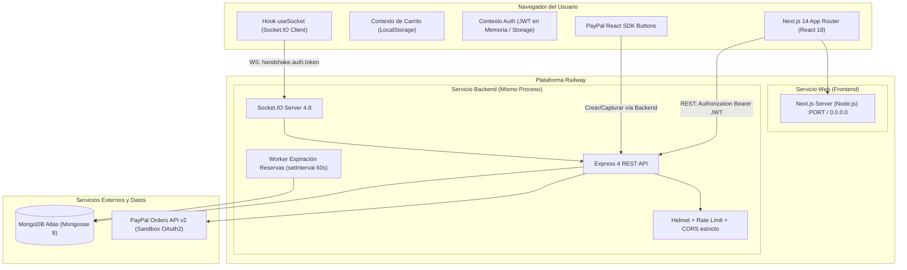
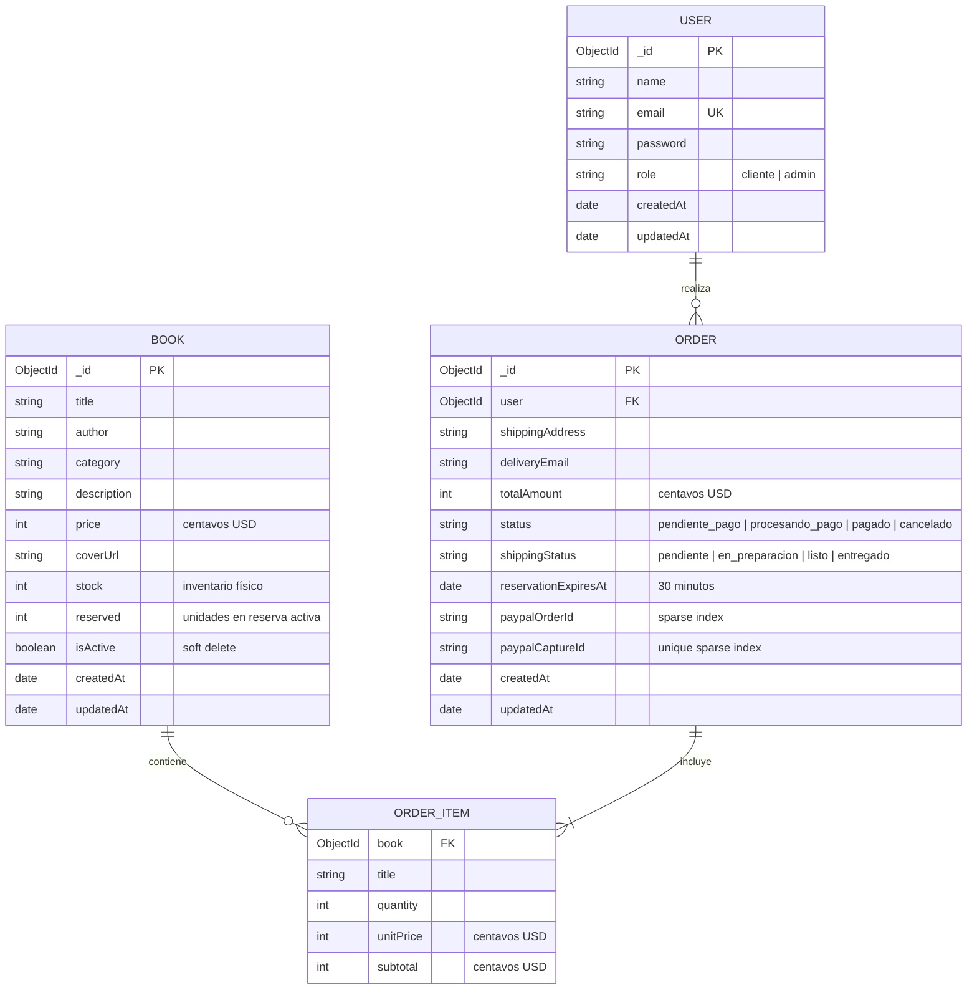
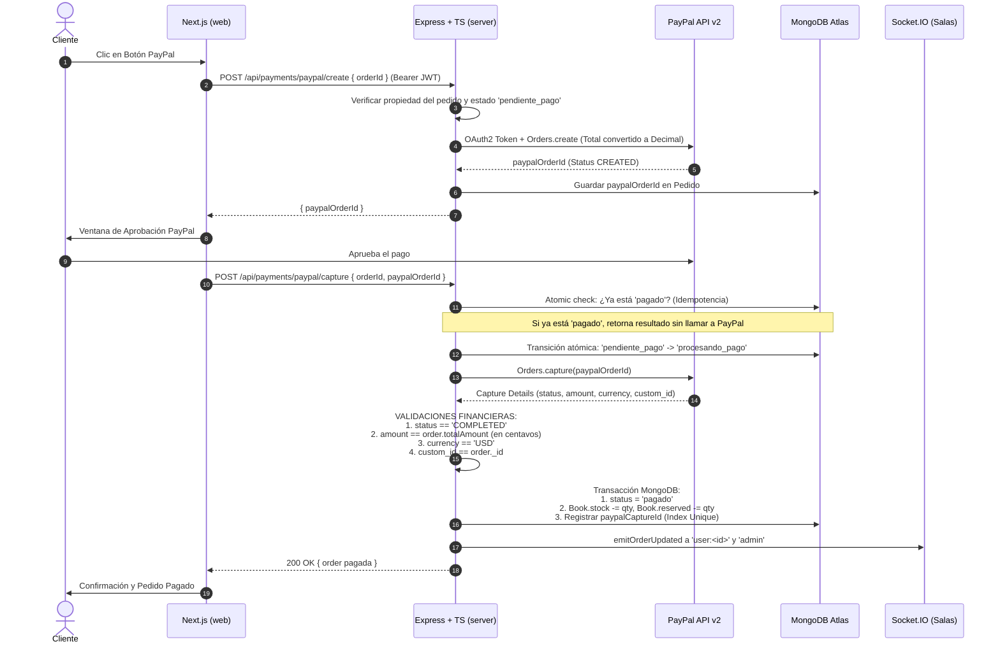
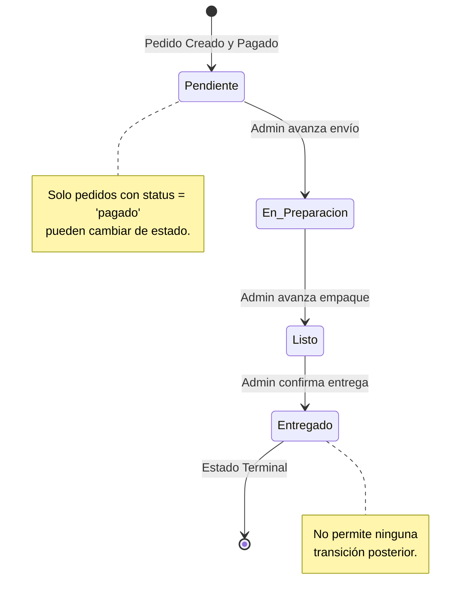
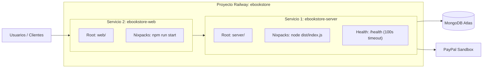

# Product Requirements Document (PRD) — EbookStore
**Versión:** 1.0.0  
**Fecha:** Noviembre 2026  
**Estado:** Aprobado / Implementado  
**Autores:** Equipo de Ingeniería Full-Stack EbookStore  

---

## 1. Resumen Ejecutivo y Objetivos

### 1.1 Visión del Producto
**EbookStore** es una plataforma de comercio electrónico moderna, de alto rendimiento y segura, especializada en la venta y entrega digital de libros electrónicos (e-books). La aplicación combina una experiencia de usuario interactiva y fluida con una arquitectura de backend robusta que garantiza consistencia transaccional, tolerancia a concurrencia y sincronización en tiempo real.

### 1.2 Objetivos Clave
- **Integridad Financiera:** Almacenamiento de todos los montos en enteros en **centavos** (USD cents) para erradicar errores de redondeo de punto flotante. Recálculo estricto de precios en el servidor, ignorando cualquier valor provisto por el cliente.
- **Reserva Atómica de Stock:** Bloqueo condicional atómico en base de datos (`$expr: { $gte: [{ $subtract: ['$stock', '$reserved'] }, quantity] }`) para evitar sobreventas bajo alta concurrencia.
- **Expiración Automática de Reservas:** Desbloqueo automático del stock si el pago no se completa en 30 minutos.
- **Integración Segura con PayPal Sandbox:** Creación y captura de órdenes en el backend con verificación de estado `COMPLETED`, moneda `USD`, coincidencia exacta de monto e idempotencia transaccional.
- **Logística y Trazabilidad:** Máquina de estados finitos estricta para el despacho de pedidos (`pendiente` → `en_preparacion` → `listo` → `entregado`) con tablero Kanban administrativo en tiempo real vía WebSockets (Socket.IO).
- **Despliegue Cloud en Railway:** Arquitectura desacoplada en dos servicios en Railway (Frontend Next.js y Backend Express/Socket.IO) con verificación continua en `/health`.

---

## 2. Personas y Casos de Uso

| Rol | Descripción | Permisos y Alcance |
|---|---|---|
| **Cliente / Comprador** | Usuario registrado o visitante que adquiere e-books para lectura digital. | • Explorar catálogo, filtrar por categorías y buscar por texto.<br>• Gestionar carrito de compras con persistencia local.<br>• Crear pedido con reserva atómica de stock de 30 minutos.<br>• Pagar de forma segura mediante PayPal Sandbox.<br>• Consultar su historial personal de pedidos (`/orders`).<br>• Recibir actualizaciones en tiempo real del estado de su pedido. |
| **Administrador** | Personal operativo y logístico de la tienda creado por Seed. | • Todo lo que hace un cliente.<br>• Crear, editar, actualizar stock y desactivar libros del catálogo.<br>• Visualizar el tablero Kanban de pedidos pagados en `/admin`.<br>• Avanzar linealmente los estados de envío de los pedidos.<br>• Recibir alertas WebSocket en tiempo real en la sala global `admin`. |

---

## 3. Arquitectura del Sistema

### 3.1 Diagrama de Arquitectura de Alto Nivel



### 3.2 Especificaciones Técnicas

#### Frontend (`web/`)
- **Framework:** Next.js 14 (App Router, Server & Client Components).
- **Estilos:** Tailwind CSS con diseño responsive mobile-first y paleta sobria (Emerald, Slate, Amber).
- **Iconografía:** Lucide React.
- **Pagos:** `@paypal/react-paypal-js` consumiendo endpoints backend (`/api/payments/paypal/*`).
- **WebSockets:** `socket.io-client` con autenticación mediante `auth.token`.
- **Autenticación:** JWT transportado exclusivamente en cabecera `Authorization: Bearer <token>` (sin cookies de sesión).

#### Backend (`server/`)
- **Runtime:** Node.js 20+ con TypeScript en modo estricto.
- **Framework Web:** Express 4.x sirviendo REST APIs y Socket.IO en el **mismo servidor HTTP / proceso**.
- **Seguridad:**
  - `helmet`: Cabeceras HTTP seguras (XSS, Clickjacking, MIME Sniffing).
  - `express-rate-limit`: Límite de tasa estricto en `/api/auth/login` y `/api/auth/register`.
  - `cors`: Restringido estrictamente a `WEB_ORIGIN` (con excepción controlada para tests internos/curl sin Origin).
- **Validación:** Esquemas Zod en todas las entradas de datos.
- **Manejo de Errores:** Middleware centralizado con clase `AppError` personalizada.
- **Monitoreo:** Endpoint `GET /health` retornando estado de base de datos, uptime y memoria.

---

## 4. Modelos de Datos y Entidades

### 4.1 Diagrama Entidad-Relación (ER)



### 4.2 Definición de Atributos Críticos
- **Unidades Monetarias:** `price`, `unitPrice`, `subtotal`, `totalAmount` son **enteros obligatorios en centavos**. Ejemplo: `$29.99` se almacena como `2999`.
- **Campos Virtuales en Book:**
  - `availableStock = stock - reserved`
  - `isAvailable = availableStock > 0 && isActive`
- **Índices Únicos y Seguros:**
  - `User.email`: Unique index.
  - `Order.paypalCaptureId`: Unique sparse index para garantizar idempotencia absoluta a nivel motor de base de datos.
  - `Book (title, author, description)`: Text index para búsqueda libre.

---

## 5. Reglas de Negocio y Flujos Críticos

### 5.1 Reserva Atómica de Stock y Creación de Pedido
1. El cliente envía `items: [{ bookId, quantity }]`, `shippingAddress` y `deliveryEmail`.
2. El backend consulta los libros en la BD y **recalcula todos los subtotales y totalAmount** con los precios oficiales. Se ignora cualquier valor enviado desde el cliente.
3. Para cada libro, ejecuta una reserva atómica condicional:
   ```typescript
   Book.findOneAndUpdate(
     {
       _id: item.bookId,
       isActive: true,
       $expr: { $gte: [{ $subtract: ['$stock', '$reserved'] }, item.quantity] }
     },
     { $inc: { reserved: item.quantity } },
     { new: true }
   );
   ```
4. **Mecanismo de Rollback:** Si un libro no tiene stock disponible suficiente, se revierte inmediatamente el stock reservado de todos los libros anteriores del pedido y se retorna `409 Conflict`.
5. Se genera la orden en estado `status: 'pendiente_pago'`, `shippingStatus: 'pendiente'` con `reservationExpiresAt: Date.now() + 30 * 60 * 1000`.

### 5.2 Expiración de Reservas (Background Job)
- Un temporizador periódico (`expiration.service.ts`) se ejecuta cada 60 segundos en el servidor.
- Busca pedidos con:
  ```typescript
  {
    status: 'pendiente_pago',
    reservationExpiresAt: { $lte: new Date() }
  }
  ```
- **Protección estricta:** Ignora deliberadamente cualquier pedido en estado `procesando_pago` para evitar condiciones de carrera durante una transacción en curso.
- Para cada pedido expirado:
  - Cambia atómicamente el estado a `'cancelado'`.
  - Decrementa `reserved` en cada libro involucrado (`$inc: { reserved: -quantity }`).

### 5.3 Flujo de Pago con PayPal Sandbox (Create & Capture Idempotente)



### 5.4 Máquina de Estados de Envíos y Tablero Kanban
El estado logístico (`shippingStatus`) sigue una **máquina de estados finitos determinista y estricta**:



#### Reglas de Validación de la Máquina de Estados:
- **Transiciones válidas únicas:**
  - `pendiente` → `en_preparacion`
  - `en_preparacion` → `listo`
  - `listo` → `entregado`
- **Rechazo estricto (HTTP 400 Bad Request):**
  - Saltos directos (ej. `pendiente` → `listo` o `pendiente` → `entregado`).
  - Regresiones de estado (ej. `en_preparacion` → `pendiente`, `listo` → `en_preparacion`).
  - Transiciones hacia el mismo estado (`pendiente` → `pendiente`).
  - Cualquier intento de cambio desde el estado final `entregado`.
  - Intentos de avanzar pedidos no pagados (`status !== 'pagado'`).

---

## 6. Limitaciones Documentadas y Manejo de Casos de Borde

### 6.1 Caso Crítico: "Cobrado pero Cancelado" (Manual Refund)
- **Escenario:** El cliente crea una orden reservando stock por 30 minutos. Deja abierta la pestaña de PayPal y no realiza la aprobación dentro de la ventana de tiempo. Transcurridos los 30 minutos, el job periódico del backend detecta la orden expirada, la marca como `cancelado` y libera el stock reservado (el cual puede ser adquirido de inmediato por otro comprador). Minutos después, el cliente aprueba la compra en PayPal y la pasarela ejecuta la captura.
- **Comportamiento del Sistema:**
  1. El endpoint `POST /api/payments/paypal/capture` valida el estado local del pedido antes y durante la transacción. Al detectar `status === 'cancelado'`, **rechaza la operación lanzando HTTP 400 Bad Request**.
  2. El pedido **no se marca como pagado** y **no se descuenta stock inexistente**.
  3. Si la captura fue debitada en PayPal antes de la confirmación local, el evento queda registrado con error crítico en los logs del servidor.
- **Procedimiento de Mitigación:** Esta situación se clasifica como una **limitación arquitectónica conocida**. El dinero retenido en la cuenta de PayPal del cliente debe ser reintegrado mediante un **Reembolso Manual (Manual Refund)** ejecutado por el Administrador desde el panel de PayPal Sandbox / Dashboard de Negocios, o programando un webhook asíncrono de reversión en evoluciones futuras.

### 6.2 Entorno Standalone de Pruebas vs. Réplica Set en Producción
- Las transacciones multinivel de Mongoose (`session.startTransaction()`) requieren un clúster tipo Replica Set (habilitado por defecto en MongoDB Atlas).
- Para permitir la ejecución completa de la suite de pruebas unitarias y de integración en entornos locales y pipelines CI/CD utilizando `mongodb-memory-server` en modo standalone, los controladores implementan un mecanismo de respaldo automático que ejecuta las operaciones atómicas de forma secuencial garantizada si las transacciones no están soportadas en el motor actual.

---

## 7. Matriz de Autorización y Control de Accesos (RBAC)

| Endpoint | Método | Autenticación Requerida | Rol Permitido | Regla de Acceso |
|---|---|---|---|---|
| `/health` | GET | No | Público | Abierto para chequeos de orquestadores / Railway. |
| `/api/auth/register` | POST | No | Público | Forzado a rol `cliente`. Rate limited. |
| `/api/auth/login` | POST | No | Público | Valida credenciales con bcrypt. Rate limited. |
| `/api/auth/me` | GET | Sí (Bearer JWT) | Cualquiera | Retorna perfil del usuario en sesión. |
| `/api/books` | GET | No | Público | Filtra solo activos (`isActive: true`). |
| `/api/books/:id` | GET | No | Público | Detalle de libro activo. |
| `/api/books` | POST | Sí (Bearer JWT) | `admin` | Alta de libros en catálogo. |
| `/api/books/:id` | PUT | Sí (Bearer JWT) | `admin` | Edición de catálogo. |
| `/api/books/:id/stock` | PATCH | Sí (Bearer JWT) | `admin` | Ajuste de stock físico. |
| `/api/books/:id` | DELETE | Sí (Bearer JWT) | `admin` | Desactivación suave (`isActive: false`). |
| `/api/orders` | POST | Sí (Bearer JWT) | `cliente`, `admin` | Reserva atómica y creación de pedido. |
| `/api/orders/my-orders` | GET | Sí (Bearer JWT) | `cliente`, `admin` | Retorna únicamente los pedidos del usuario autenticado. |
| `/api/orders/:id` | GET | Sí (Bearer JWT) | Propietario o `admin` | Verificación estricta: `order.user == req.user.id || role == 'admin'`. |
| `/api/payments/paypal/create` | POST | Sí (Bearer JWT) | Propietario | Solo el dueño del pedido puede iniciar pago PayPal. |
| `/api/payments/paypal/capture` | POST | Sí (Bearer JWT) | Propietario | Solo el dueño puede capturar el pago. |
| `/api/admin/orders` | GET | Sí (Bearer JWT) | `admin` | Listado paginado y filtrado de pedidos. |
| `/api/admin/orders/:id/shipping-status` | PATCH | Sí (Bearer JWT) | `admin` | Transición estricta de estado de envío. |
| `/api/admin/dashboard` | GET | Sí (Bearer JWT) | `admin` | Ruta testigo de autorización RBAC. |

---

## 8. Estrategia de Despliegue en Railway

La aplicación se despliega como dos servicios independientes dentro del mismo proyecto de Railway:



- **Variables de Entorno del Backend:** `PORT`, `HOST=0.0.0.0`, `NODE_ENV=production`, `WEB_ORIGIN`, `MONGODB_URI`, `JWT_SECRET`, `ADMIN_PASSWORD`, `DEMO_PASSWORD`, `PAYPAL_CLIENT_ID`, `PAYPAL_CLIENT_SECRET`, `PAYPAL_MODE=sandbox`.
- **Variables de Entorno del Frontend:** `NEXT_PUBLIC_API_URL`, `NEXT_PUBLIC_SOCKET_URL`, `NEXT_PUBLIC_PAYPAL_CLIENT_ID`.
